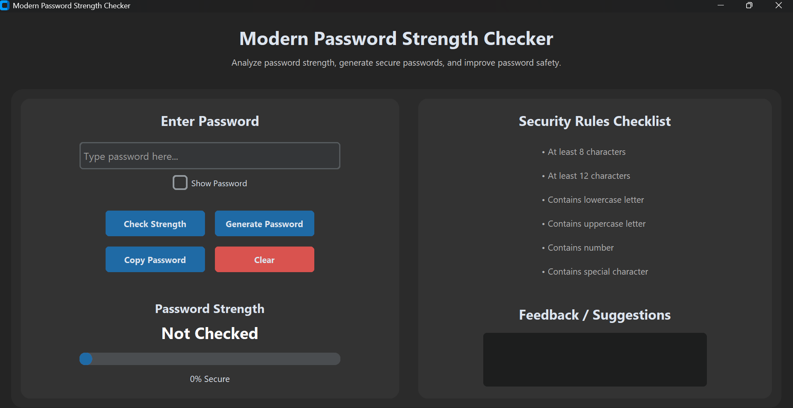
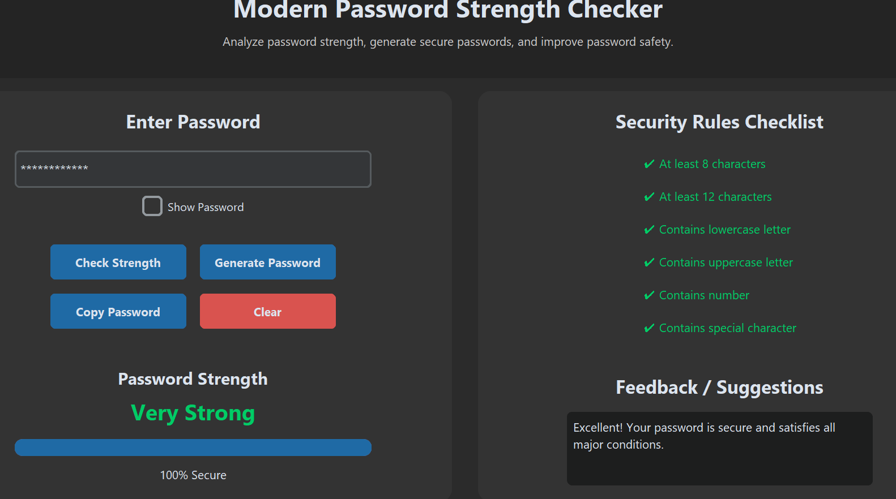
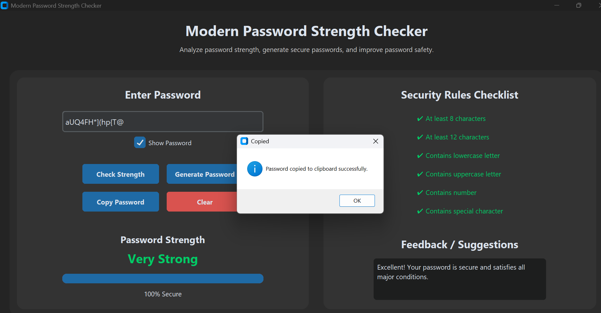

Modern Password Strength Checker

A Windows-only desktop application built using Python and CustomTkinter. It provides a modern graphical user interface (GUI) to analyze password strength and help users create stronger passwords.

✨ Features

- Password strength analysis
- Real-time password feedback
- Security rules checklist
- Random password generator
- Show/Hide password option
- Copy password to clipboard
- Clear input functionality
- Modern dark-themed GUI

🖥️ Platform

- Operating System: Windows 10 / Windows 11
- Language: Python
- GUI Framework: CustomTkinter

📥 Installation & Download

Option 1: Download the Windows Application

1. Open the Releases section of this repository.
2. Download the latest ".exe" file.
3. Open the downloaded file on your Windows PC.
4. Follow the on-screen instructions, if any.

Option 2: Run from Source Code

1. Install Python on your Windows PC.

2. Clone or download this repository.

3. Open the project folder in VS Code or a terminal.

4. Install the required dependency:
   
   pip install -r requirements.txt

5. Run the application:
   
   python Modern-Password-Strength-Checker.py

🚀 How to Use

1. Launch the application.
2. Enter a password in the input field.
3. Check the displayed strength and security feedback.
4. Use the password generator to create a password.
5. Copy or clear the password whenever required.

🛠️ Technologies Used

- Python
- CustomTkinter
- Tkinter
- Random module

Project Structure

Modern-Password-Strength-Checker/
│
├── Modern-Password-Strength-Checker.py
├── requirements.txt
├── README.md
└── .gitignore

## 📸 Application Screenshots

### Main Interface

### Password Strength Analysis

### Password Generator

Created by

Arjun Kumar

---

⭐ If you find this project useful, consider giving this repository a star!
